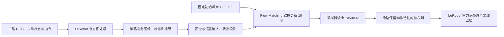

# Task 011 · SmolVLA 输入敏感性与动作输出验证

2026-11-21（Asia/Shanghai）。八次离线推理完成，三个输入模态的六项单因素干预都产生了可辨识的动作差异。匹配统计的物理反归一化为 `BLOCKED`，因为官方组件在这份检查点配置下原样返回动作张量。

- **INFERENCE VALID**。八组输出均为 `[1,50,6]` float32，所有元素有限。E01 与 E02 的 300 个动作值完全一致。
- **INPUT SENSITIVITY OBSERVED**。固定噪声后，两组语言、两组视觉、两组状态干预均超过本轮数值判据。
- **SEMANTIC CORRECTNESS NOT VERIFIED**。实验使用合成输入，无任务成功率、动作单位或硬件执行证据。

## Task 010 证据审查

| 对象 | 分类或核实结果 |
|---|---|
| 三路 RGB 图像 | `SYNTHETIC`。代码以 `torch.full` 建立背景，在第一、第二路的固定像素区域提高单一颜色通道。第三路为常量图。 |
| 状态与指令 | `SYNTHETIC`。均为脚本中的字面量。状态值接近缓存统计中的若干均值，但缓存键为动作统计。缺少真实帧出处、时间戳、状态字段定义、单位及采集记录。 |
| 图像、状态及指令是否同步采集 | 三者组成同一合成测试记录。真实观测关联、相机物理视角及标定均为 `UNKNOWN`。 |
| Task 010 处理器调用 | 通过官方 `make_pre_post_processors` 构造处理器，覆盖 CPU，调用 `preprocess`、`_get_action_chunk` 和 `postprocess`。另行执行的 `select_action` 有独立采样流程，无法视为存档 Chunk 的第一步。 |
| Task 010 动作存档 | `full_post_chunk` 保存官方后处理返回的全块 `[50,6]`，省去批次轴。原始策略输出只保存第 0、24、49 行。后处理保存位置与反归一化是否实际生效是两个检查项。 |
| 维度 | 检查点 `chunk_size=50`、`n_action_steps=50`、`action.shape=[6]`，与 Task 010 保存的 `[1,50,6]` 一致。第 0～5 列的关节对应关系、单位、符号、坐标系、绝对或增量约定、采样频率均为 `UNKNOWN`。 |

`OFFICIAL_DATASET` 用于有可追溯数据集、episode/frame 与同步元数据的样本，`USER_PROVIDED` 用于由用户提供且保留来源记录的数据，`UNKNOWN` 用于来源无法确认的对象。本轮八组输入均为 `SYNTHETIC`。原 Task 010 文件保留，以上审查覆盖其中关于真实状态、物理量程和动作频率的未经验证推断。`Task 010 脚本` · `输入来源记录`

## 实验方法

在现有 `.venv` 中离线加载 `lerobot/smolvla_base` 的缓存修订 `5e8d12a6e2975b0e5e5fce7c8caf47c371d257b6`，使用 CPU、评估模式、checkpoint 原有 10 步推理配置。采用 Task 010 的 Case 001，由代码重建其原始图像张量，并核对指令、状态和已有存档一致。Task 010 未归档原始图像哈希，本轮重建以其确定性代码为依据。八次调用共用一个由种子 `20261120` 生成的 `[1,50,32]` float32 高斯噪声张量，显式传入模型，每次复制噪声、重设随机种子及清空策略队列。PyTorch 启用确定性算法，线程数以环境记录为准。这个设计比较固定噪声下的输入效应，未估计跨种子变化分布。

| 编号 | 相对 E01 的唯一改动 |
|---|---|
| E01 | Case 001 原指令 `pick the blue block and place it on the plate`、三路图与六维状态 `[1.59,119.94,109.76,56.70,-27.42,12.00]`。 |
| E02 | 原样重复。 |
| E03 | 指令中 `blue` 换为 `red`。 |
| E04 | 仅把指令换成 `open the gripper and release the target object`。 |
| E05 | 仅交换 camera1 的红、蓝通道。 |
| E06 | 仅将 camera2 的色块向右循环平移 48 像素。 |
| E07 | 仅将状态索引 0 从 1.59 改为 2.00。 |
| E08 | 仅将状态索引 1 从 119.94 改为 120.94。 |

视觉干预保留 `[3,256,256]`、float32 和 `[0,1]`。两处状态干预保留 `[6]` 和 float32，改动值落在 Task 010 合成样例相应列的最小值与最大值之间，物理设备合法范围为 `UNKNOWN`。每例保存原始输入、预处理批次及实际传入 `sample_actions` 的张量。张量哈希对连续 CPU 数组的 C 顺序原始字节计算 SHA-256，另存形状、dtype、范围及 NPZ 文件哈希。语言比较同时检查 token ID 和 attention mask，等长文本的 mask 可以保持一致。



处理链先增加批次轴、处理指令换行、分词至 48 个位置并迁移至 CPU。三个 `observation.images.camera1`、`camera2`、`camera3` 各自从 `[3,256,256]` 变为 `[1,3,256,256]`，策略内部再缩放至 `[1,3,512,512]` 并用 `2x−1` 转换像素范围。三路均提供实际张量及启用的图像 mask。状态在处理器后为 `[1,6]`，随后补零至 `[1,32]`。动作专家在同一采样过程中更新整块 50 个位置，从 `[1,50,32]` 的内部结果裁出 `[1,50,6]`。50 是预测步数，真实秒数与动作频率没有相应元数据。`检查点及包版本` · [实际配置](../results/task011/metrics/runtime_config.json)

## 归一化核查

缓存的官方 pre/post 配置声明 `STATE=MEAN_STD`、`ACTION=MEAN_STD`，但两个统计文件只含 `so100.buffer.action`、`so100-blue.buffer.action`、`so100-red.buffer.action` 三组均值与标准差。已安装 LeRobot 按完整特征键查找统计，键缺失时返回输入值。因此要分别检查 `observation.state` 与 `action` 的运行时统计键及数值差异。即使这些候选统计来自同一模型快照，也缺少证据将某组绑定到本实验状态或动作特征。以 `BLOCKED` 标记匹配统计的物理反归一化，禁止猜测重命名或任意套用某组参数。[处理器与统计审计](../results/task011/metrics/processor_audit.json)

另外逐项比对了 Task 010 的三个存档。每组的第 0、24、49 行原始值与后处理值完全相同。旧文件只保留这三个原始步，本轮以全部 300 个采样元素进一步核实。

八组官方预处理后的六维状态与原始状态逐元素一致，策略内部另做补零。八组官方后处理输出与六维策略预测也逐元素一致，原始与后处理之间的 MAD、RMSE 和最大绝对差均为 0。两个阶段的组件确实执行，所需的统计变换均未发生。[Task 010 样本比对](../results/task011/metrics/task010_output_audit.json)

## 实测结果

以下差值均相对 E01，对六维策略输出的全部 300 个元素计算。MAD 为绝对差均值，RMSE 为差值均方根。以最大绝对差超过 `max(1e-6, 10×重复基准最大绝对差)` 判定本轮可辨识变化。这里的阈值为 `1e-6`，用于比较数值，未定义任务通过门槛。

| 编号 | 模型入口实际变化 | MAD | RMSE | 最大绝对差 | 推理与输入归档（秒） |
|---|---|---:|---:|---:|---:|
| E01 | 基准 | 0 | 0 | 0 | 113.442 |
| E02 | 无 | 0 | 0 | 0 | 146.150 |
| E03 | 语言 token ID | 0.101421 | 0.141143 | 0.339636 | 108.325 |
| E04 | 语言 token ID、attention mask | 0.343310 | 0.411952 | 0.853374 | 100.892 |
| E05 | 第一路图像张量 | 0.056224 | 0.070437 | 0.355061 | 110.758 |
| E06 | 第二路图像张量 | 0.034420 | 0.044012 | 0.078187 | 122.559 |
| E07 | 状态索引 0 | 0.001312 | 0.001713 | 0.008813 | 77.685 |
| E08 | 状态索引 1 | 0.001491 | 0.001888 | 0.007077 | 107.421 |

E03 改词后 token 数未变，因此 attention mask 哈希一致。E05 和 E06 的三路有效掩码始终为真。E07 和 E08 的变化仅在各自指定的状态元素，另外 31 个入口状态元素不变。六项干预均有数值影响，没有未观察到变化的干预组。影响幅度仅适用于本轮样本与扰动大小。第三路相机全程固定，单独改变该路的影响未测。

归档后独立打开全部 32 个逐例输入／输出 NPZ，复算文件与张量哈希、对照原始及模型入口差异、检查数值有限性和队列状态，并从动作数组重新计算差值。八例均通过。内存采样峰值 RSS 为 3413 MiB，系统采样最低可用内存为 5268 MiB，采样期 Swap 使用峰值为 0 MiB。现有环境的 CPU 权重加载阶段出现 CUDA 不可用回退提示及 API 弃用提示，八次推理全部完成。复核 863 个既有文件和检查点文件的哈希，均一致。进程以退出码 0 结束，模型资源已释放。[归档复核与验收](../results/task011/acceptance.json) · `资源统计`

## A 模块数据接入建议

1. 与 A 模块先约定离线观测记录，包含样本 ID、来源类别、各路相机 ID、时间戳、RGB 帧及哈希、状态字段名与单位、标定版本、同步依据和任务文本。保留原始记录与处理后的记录，两者以 ID 对应。
2. 先用录制数据做只读映射与校验。以明确文档将三路帧绑定到模型相机键，检查时间一致性、数据类型和像素范围。核实六维值的字段顺序、单位及适用范围，再构造状态向量。状态映射缺失、时间不匹配或统计不适配时，记录缺失字段并停止该样本推理。检测框等派生数据可保留为附加元数据，SmolVLA 当前视觉入口需要 RGB。
3. 对一个已核实的记录复跑固定噪声对照，随后逐步扩展多个 episode 和种子。将预测、输入与对应的参考记录关联，分别验证可重复性、输入敏感性及任务评价。输出仍归档为预测数据，设备执行与控制验证属于独立阶段。

## 复现与归档

从工程根目录用现有 Python 环境运行。脚本要求新的 `results/task011/` 目录，复跑前需归档该目录，以保留本轮证据。

```bash
OPENBLAS_NUM_THREADS=4 OMP_NUM_THREADS=4 MKL_NUM_THREADS=4 PYTHONDONTWRITEBYTECODE=1 \
  vla-learning/.venv/bin/python -u vla-learning/scripts/task011_input_sensitivity.py
```

- `inputs/` 保存每例的 `_raw.npz`、`_preprocessed.npz`、`_model_boundary.npz`，基准图 PNG 用于查看，精确像素以 NPZ 为准。指令原文保存在对应预测 JSON，共用噪声另存 `common_noise.npz`。
- `predictions/` 每例包含完整的六维原始和官方后处理动作 JSON，以及含内部 32 维输出、六维策略输出和六维后处理输出的 NPZ。每个动作维度记录最小值、最大值、均值和相邻步平均及最大绝对差。
- `metrics/` 记录包版本、检查点与历史文件哈希、配置、统计键、逐例指标及内存采样。`logs/run.log` 记录实际运行。前次人工中断只留下预扫描哈希与日志，保存在 `results/task011-interrupted/`，未计入本轮推理次数。

`实验脚本` · [验收记录](../results/task011/acceptance.json) · [逐例数据与差值](../results/task011/metrics/experiments.json)

