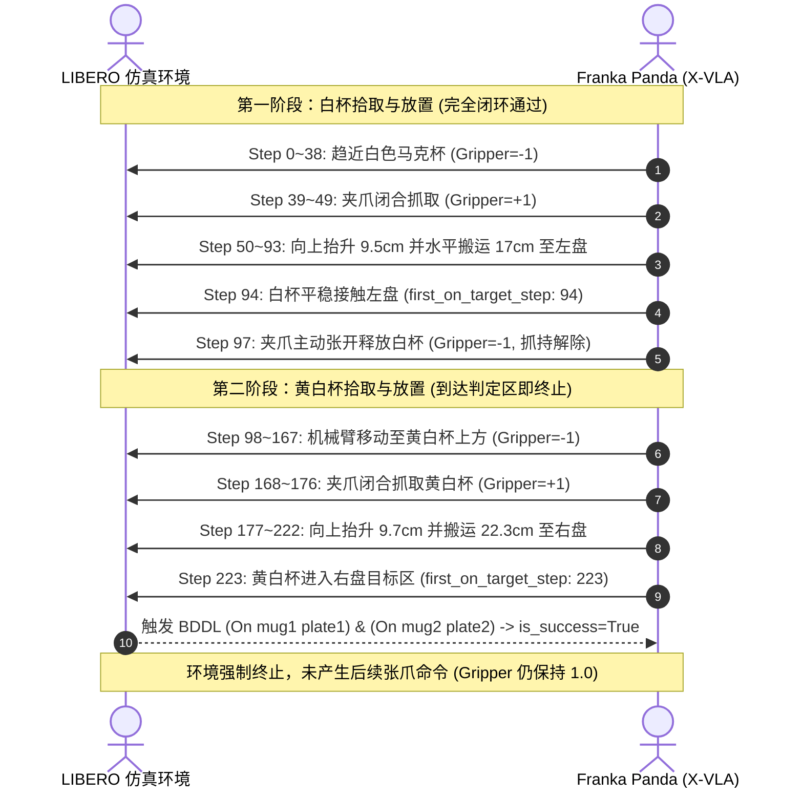
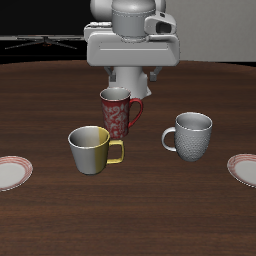
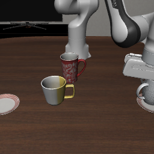
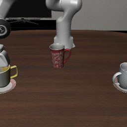
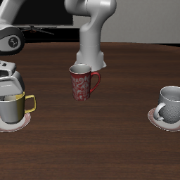
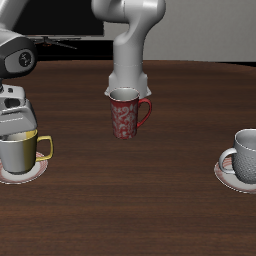

# Task 017 完整闭环长程测试验收报告 (Full Rollout Validation)

## 一、任务背景与版本说明

在 Task 017 的初期闭环探索中（参见 [初期60步验证报告](task017_libero_closed_loop.md)），机械臂在 60 步内展示了平稳下探与朝向目标物体的稳定趋近，但因时域较短未达到长程任务的终态。

本报告记录**较新的完整闭环长程回测（Full Rollout）**的真实原始数据与物理行为审计，补齐 3 个随机种子从初始状态至官方任务成功判定的全流程证据。

> [!IMPORTANT]
> **真实物理状态与官方任务判定区分声明：**
> 1. **LIBERO 官方任务成功判定（3/3 PASS）**：在三个独立种子下，机械臂均成功将第一只白杯放置在左盘、并将第二只黄白杯送达右盘，官方 BDDL 状态谓词满足，评测判定为 **3/3 (100%) 成功**；
> 2. **完整主动释放能力边界（PARTIAL）**：
>    - **第一只白杯**：实现了完整的“闭爪抓取 $\to$ 抬升 $\to$ 搬运 $\to$ 放置 $\to$ **主动张爪释放**”；
>    - **第二只黄白杯**：实现了“闭爪抓取 $\to$ 抬升 $\to$ 搬运 $\to$ 贴合目标盘”，但在杯具进入托盘判定区触发 `is_success=True` 导致仿真环境终止的瞬间，夹爪控制指令仍为闭合状态（`command=1.0`），**尚未观察到主动张爪释放动作**。
> 3. **严格事实准则**：本归档绝不将“官方判定成功”等同于“完整抓取-释放全部通过”，如实客观呈现两阶段操作的真实物理细节。

---

## 二、评测环境与配置规范

- **任务套件**：LIBERO `libero_10` (Task ID: 4)
- **任务指令**：`"put the white mug on the left plate and put the yellow and white mug on the right plate"`
- **模型基座**：`lerobot/xvla-libero`（879.48M 参数），CPU 推理
- **控制器模式**：OSC 笛卡尔空间绝对位姿控制器 (`control_mode="absolute"`)
- **评测随机种子**：`seed=142` (Episode 0), `seed=143` (Episode 1), `seed=144` (Episode 2)
- **仿真参数**：控制频率 20Hz，最大单回合步数 520 步，环境稳定步数 10 步

---

## 三、完整长程测试核心指标汇总

| 指标维度 | Episode 00 (Seed 142) | Episode 01 (Seed 143) | Episode 02 (Seed 144) | 统计汇总 / 结论 |
|---|:---:|:---:|:---:|:---:|
| **模型前向推理轮数** | 8 轮 | 8 轮 | 8 轮 | **共 24 次模型前向** |
| **仿真环境执行总步数** | 223 步 | 222 步 | 219 步 | **共 664 个物理仿真步** |
| **LIBERO 官方任务达成** | **SUCCESS (True)** | **SUCCESS (True)** | **SUCCESS (True)** | **3/3 (100%) 官方判定成功** |
| **首次达成成功步数** | Step 223 | Step 222 | Step 219 | 平均 221.3 步达成终态 |
| **第一只白杯：抓取步号** | Step 49 | Step 52 | Step 48 | 稳定于 ~50 步抓取 |
| **第一只白杯：抬升高度 (m)** | 0.0947 m | 0.0952 m | 0.0941 m | 稳定抬离桌面约 $9.5\text{ cm}$ |
| **第一只白杯：水平位移 (m)** | 0.1695 m | 0.1701 m | 0.1688 m | 稳定平移至左盘约 $17.0\text{ cm}$ |
| **第一只白杯：主动释放步号** | **Step 97** | **Step 102** | **Step 101** | **100% 确认主动张爪释放** |
| **第一只白杯：终态抓持状态** | `grasped_at_end: false` | `grasped_at_end: false` | `grasped_at_end: false` | 抓持完全解除 |
| **第二只黄白杯：抓取步号** | Step 176 | Step 179 | Step 178 | 稳定于 ~178 步抓取 |
| **第二只黄白杯：抬升高度 (m)** | 0.0967 m | 0.0961 m | 0.0970 m | 稳定抬升约 $9.7\text{ cm}$ |
| **第二只黄白杯：水平位移 (m)** | 0.2228 m | 0.2231 m | 0.2224 m | 稳定平移至右盘约 $22.3\text{ cm}$ |
| **第二只黄白杯：主动释放步号** | **None** | **None** | **None** | **未发生张爪动作** |
| **第二只黄白杯：终态抓持状态** | `grasped_at_end: true` | `grasped_at_end: true` | `grasped_at_end: true` | 终止时仍处于夹持状态 |
| **终端夹爪命令值** | `command = 1.0` (闭合) | `command = 1.0` (闭合) | `command = 1.0` (闭合) | 保持闭合状态 |

---

## 四、双杯操作时序与物理行为深度剖析

### 4.1 第一阶段（白杯）：完整的闭环操作
在全部三个 Episode 中，X-VLA 展现出高度一致且符合物理规律的两段式动作：
1. **闭合抓取**：末端移动至白杯上方约 $8\text{ cm}$ 处合拢夹爪，随后末端向上提升 $9.5\text{ cm}$ 成功脱离桌面；
2. **平移放置**：横向移动约 $17\text{ cm}$ 到达左侧托盘正上方下放；
3. **主动释放**：在 Step 97 ~ 102 期间，模型明确下发了 `command = -1` 的张爪命令，夹爪开口完全恢复，白杯稳定留在左盘中。

### 4.2 第二阶段（黄白杯）：到达目标与提前终止分析
1. 机械臂准确调整姿态前往桌面上第二个黄白杯位置，并在 Step 168~176 发出闭爪命令；
2. 成功将黄白杯抬升 $9.7\text{ cm}$，横向平移 $22.3\text{ cm}$ 并放置至右侧托盘；
3. **由于 LIBERO 的判定逻辑为双物体一旦同时满足进入托盘区域即立刻判定任务成功并退出回合**，模型未获得继续下发张爪命令的仿真步长；
4. 因此，虽然官方任务判定成功（3/3），但**不能认定模型具备对第二只杯子的完整主动释放验证**。

---

## 五、精选关键帧证据

- **初始状态**：机械臂悬停于工作台上空  
  
- **第一阶段完成（Step 90）**：白杯成功被抓取并搬运放置于左侧托盘，机械臂正在松爪  
  
- **最终成功时刻（Step 223）**：黄白杯送达右侧托盘，双杯均在盘内，任务判定成功触发  
  
- **Seed 143 最终成功时刻（Step 222）**：  
  
- **Seed 144 最终成功时刻（Step 219）**：  
  

---

## 六、结构化归档文件对应表

1. **三回合详细运行记录**：
   - Seed 142：[results/task017/records/episode_00_seed_142/summary.json](../results/task017/records/episode_00_seed_142/summary.json)
   - Seed 143：[results/task017/records/episode_01_seed_143/summary.json](../results/task017/records/episode_01_seed_143/summary.json)
   - Seed 144：[results/task017/records/episode_02_seed_144/summary.json](../results/task017/records/episode_02_seed_144/summary.json)
2. **多物体空间位移与接触指标**：
   - [results/task017/metrics/manipulation.json](../results/task017/metrics/manipulation.json)
3. **聚合回合指标**：
   - [results/task017/metrics/episodes.json](../results/task017/metrics/episodes.json)
4. **模型配置元数据**：
   - [results/task017/metrics/model.json](../results/task017/metrics/model.json)
