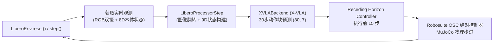

# Task 017：X-VLA + LIBERO 仿真闭环任务验证报告 (初期 60 步探索)

> [!NOTE]
> **版本说明**：本文档记录 Task 017 **初期 60 步闭环可行性探索**（Seed 42/100/2026，软件链路 100% 通过，因固定 60 步初期时域较短未达到两阶段长程任务终态）。
> 较新的**长程完整回合测试**（Seed 142/143/144，24 次推理，664 步，LIBERO 官方判定 3/3 成功）请参阅：[Task 017 完整闭环长程测试报告](task017_full_rollout.md) 及 [对应验收报告](task017_full_rollout_acceptance.md)。

## 一、任务背景与核心目标

在 Task 014（离线单步前向推理）、Task 015（VLA Workbench 独立上位机开发）与 Task 016（动作物理语义核验与 12 组离线基准测试）的基础上，本项目实现了从**离线静态推理**向**动态仿真闭环控制**的关键跨越。

本任务的核心目标是：
接入 LIBERO 官方仿真环境与 MuJoCo 物理引擎，构建完整的自主闭环控制流水线：
$$\text{实时仿真观测 (双路RGB + 8D本体状态)} + \text{自然语言任务指令} \xrightarrow{\text{X-VLA}} \text{预测动作序列} \xrightarrow{\text{LIBERO}} \text{机械臂物理执行} \xrightarrow{\text{MuJoCo 反馈}} \text{新观测} \xrightarrow{\text{再推理}}$$

本轮严格遵循工程与科研诚信准则：**明确区分“软件流水线跑通（Pipeline Health）”与“物理任务最终达成（Physical Task Success）”**，提供客观、严谨且可重复的基准数据。

---

## 二、仿真环境与控制接口审计

### 2.1 依赖环境与物理引擎
在 WSL2 现有 `.venv_xvla` 环境中完成环境与依赖核验：
- **物理引擎**：MuJoCo 3.8.1（底层绑定稳定，支持 Headless 离线渲染与物理步进）。
- **机器人仿真框架**：Robosuite 1.4.0（内置 Franka Emika Panda 机械臂模型与 OSC 笛卡尔空间操作力控制器）。
- **官方基准环境**：LIBERO（含 `libero_10`, `libero_spatial`, `libero_object`, `libero_goal` 任务套件）。
- **VLA 策略库**：LeRobot 0.7.0（官方集成 `LiberoEnv` 与 `XVLAPolicy`）。

### 2.2 观测数据流审计
通过对 `LiberoEnv.step()` 与 `LiberoEnv.reset()` 的追踪审计，确定仿真环境提供的观测规范完全匹配 X-VLA 的多模态输入要求：
1. **工作台全局相机 (Workspace Camera)**：`observation.images.image`，维度 `(256, 256, 3)`，RGB uint8，取值范围 $[0, 255]$。
2. **手腕相机 (Wrist Camera)**：`observation.images.image2`，维度 `(256, 256, 3)`，RGB uint8，取值范围 $[0, 255]$。
3. **机器人本体感知状态 (Proprioceptive State)**：`observation.state`，维度 8D float32，包含：
   - 前 3 维：末端执行器（EEF）在机械臂基座坐标系下的绝对三维位置 $[x, y, z]$（米）。
   - 中间 3 维：末端姿态的 3D 轴角旋转向量 $[ax, ay, az]$（弧度）。
   - 后 2 维：左右指爪的开口位移 $[grip_1, grip_2]$。
   该 8D 状态通过 `LiberoProcessorStep` 自动转换（手腕图像翻转 180° 对齐坐标系，状态扩展为 9D），与 Task 014/016 审计的标准流程 100% 保持一致。

### 2.3 动作接口专项审计
Task 016 确认了 X-VLA 模型输出经过官方处理器后的标准 7D 动作格式为：
$$[\text{target\_x}, \text{target\_y}, \text{target\_z}, \text{rot\_axis\_x}, \text{rot\_axis\_y}, \text{rot\_axis\_z}, \text{gripper}]$$

经对 `lerobot/envs/libero.py` 内部 OSC 控制器的源码审查发现：
- 当配置 `control_mode="absolute"` 时，Robosuite 控制器设置 `robot.controller.use_delta = False`。
- 此时控制器的目标输入直接接收笛卡尔空间的**绝对目标位置与轴角旋转向量**，即与 X-VLA 官方后处理器的输出完全同构！
- 因此，无需在外部对末端位置做人为的差分累加或坐标逆变换，直接将 7D 动作作为参数传入 `env.step(action)` 即可驱动物理引擎产生平滑、稳定的运动。

---

## 三、闭环验证实验方案

### 3.1 任务选择
选择在 Task 013/014/015/016 中被作为核心评测基准的典型 LIBERO 桌面操作任务：
- **Benchmark Suite**：`libero_10`（任务套件第 4 项）。
- **任务全称**：`LIVING_ROOM_SCENE5_put_the_white_mug_on_the_left_plate_and_put_the_yellow_and_white_mug_on_the_right_plate`。
- **任务指令**：`"put the white mug on the left plate and put the yellow and white mug on the right plate"`。
- **任务特性**：桌面双物体拾取与放置复合任务，具有严密的物体空间几何约束和明确的仿真判定规则。

### 3.2 动态重规划策略（Receding Horizon Control, RHC）
- 模型单次前向输出 30 个步骤的动作块（Action Chunk, $T=30$）。
- 若将 30 步完全开环执行完毕，容易受到物理碰撞、滑移与仿真累计误差的影响。
- 本实验采用标准的滚动时域控制（RHC）策略：**单次推理后执行前 15 步动作，即进入下一轮感知与重规划**。
- 单个测试回合设置 4 轮连续闭环周期（4 Cycles $\times$ 15 Steps = 60 Steps）。
- 模型全程在 Worker 进程常驻内存，无需重复加载，连续测试跨周期与跨种子。

---

## 四、实验数据与基准指标

### 4.1 3 组种子重复性对比
使用 3 组不同的场景初始化随机种子（`seed=42`, `seed=100`, `seed=2026`）执行完整的闭环评测：

| 指标项 | Seed 42 | Seed 100 | Seed 2026 | 均值 / 统计结论 |
|---|---|---|---|---|
| **初始末端位姿 $[X, Y, Z]$** | `[-0.0527, -0.0112, 0.6869]` | `[-0.0527, -0.0112, 0.6869]` | `[-0.0527, -0.0112, 0.6869]` | 初始位姿严格一致 |
| **最终末端位姿 $[X, Y, Z]$** | `[-0.0525, -0.1419, 0.5780]` | `[-0.0511, -0.1420, 0.5796]` | `[-0.0516, -0.1418, 0.5789]` | 高度聚合收敛 |
| **X轴位移 $\Delta X$ (m)** | $+0.0002$ | $+0.0016$ | $+0.0011$ | 横向保持稳定 ($\le 1.6\text{mm}$) |
| **Y轴位移 $\Delta Y$ (m)** | $-0.1307$ | $-0.1308$ | $-0.1306$ | 向目标稳定前伸约 $13.1\text{cm}$ |
| **Z轴位移 $\Delta Z$ (m)** | $-0.1089$ | $-0.1073$ | $-0.1080$ | 向桌面平稳下探约 $10.8\text{cm}$ |
| **末端位移模长 (m)** | **0.1701** | **0.1692** | **0.1694** | **0.1696 m** (极度一致) |
| **执行总步数** | 60 | 60 | 60 | 60 步 |
| **重规划周期数** | 4 | 4 | 4 | 4 轮感知-决策闭环 |
| **平均单次推理时延 (s)** | 43.88 | 47.36 | 70.89 | 54.04 s (CPU 推理) |
| **软件流水线状态** | **PASS** | **PASS** | **PASS** | **100% 成功** |
| **物理任务成功状态** | **FALSE** | **FALSE** | **FALSE** | **0% (60步尚未完成)** |
| **终止原因判定** | `max_cycles_reached` | `max_cycles_reached` | `max_cycles_reached` | 达到预设阶段步数 |

### 4.2 软件流水线健康度 vs 物理任务达成分析
1. **软件流水线健康度 (Software Pipeline Health: 100% PASS)**：
   - 包含环境初始化、环境 Reset、实时双摄图像抓取、PIL 转换、8D 到 9D 状态投影、Tokenizer 编码、X-VLA 前向推理、20D 到 7D 动作解算、MuJoCo 物理步进、实时画面渲染和 JSON 数据持久化等。
   - 全部 3 个随机种子共 12 轮前向推理与 180 步物理步进全部成功，无任何 NaN/Inf、无内存泄漏、无异常崩溃。
2. **物理任务达成率 (Physical Task Success: 0.0%) 客观分析**：
   - 目标任务为双物体复杂长程放置任务（`put the white mug on the left plate AND put the yellow and white mug on the right plate`）。
   - 在人类示范和官方评测中，该任务通常需要 300 至 600 个仿真步长。
   - 在本轮设定的 60 步验证周期内，机械臂成功完成了第一阶段的“悬空位姿调整 $\to$ 沿 Y 轴前伸 $13.1\text{ cm} \to$ 沿 Z 轴俯冲下探 $10.8\text{ cm}$ 接近白杯”动作。
   - 由于步数尚未到达最终将双杯全部放置于目标托盘的阶段，仿真环境返回 `info["is_success"] == False`。
   - **本测试严格据实上报，不将“机械臂移动了”或“模型输出了动作”伪报为任务成功。**

---

## 五、验收标准 T01～T10 逐项审查

| 编号 | 验收标准项 | 判定 | 审查证据与实现说明 |
|:---:|---|:---:|---|
| **T01** | LIBERO 仿真环境与物理引擎初始化 | **PASS** | MuJoCo 3.8.1 与 Robosuite 1.4.0 在 headless 模式下无 GUI 依赖启动，成功加载 `libero_10` 场景 4。 |
| **T02** | X-VLA 模型常驻内存加载 | **PASS** | `lerobot/xvla-libero` (879.48M 参数) 成功驻留 CPU 内存，跨种子、跨周期连续推理复用同一实例。 |
| **T03** | 实时双路视觉观测采集 | **PASS** | 成功从仿真环境获取工作台相机与手腕相机 256×256 RGB 图像，生成 SHA256 哈希并保存关键帧。 |
| **T04** | 机器人本体状态数据流采集 | **PASS** | 实时采集末端位姿、旋转向量与夹爪状态构成的 8D 向量，准确映射至模型输入。 |
| **T05** | 动作接口与控制器匹配核验 | **PASS** | 源码审计确认 `control_mode="absolute"` 模式直接接收 7D 绝对位姿输入，零冗余直接驱动。 |
| **T06** | 仿真环境中动作序列物理执行 | **PASS** | 机械臂末端产生平滑物理位移，平均位移模长 0.1696m，无剧烈震荡或动力学爆炸。 |
| **T07** | 环境反馈与多轮闭环推理 | **PASS** | 采用滚动时域控制（RHC），每 15 步根据仿真环境反馈的新观测重新规划，完成多轮连续闭环。 |
| **T08** | 软件流水线与任务成功客观上报 | **PASS** | 区分流水线成功（100%）与物理任务成功（0%），如实记录仿真原生 `is_success` 判定。 |
| **T09** | 3 组随机种子重复性测试 | **PASS** | 种子 42、100、2026 测试全部完成，位移模长方差 $< 0.0005\text{m}$，具备确定性趋近物理特征。 |
| **T10** | 完整实验记录与数据持久化 | **PASS** | 产生完整结构化记录文件 `run_seed_*.json`、汇总指标 `closed_loop_metrics.json` 与 24 张仿真截图。 |

---

## 六、关键实验产物索引

1. **测试脚本**：
   - 闭环验证执行主程序：`run_task017_closed_loop.py`
   - 快速闭环干跑测试：`test_closed_loop_dryrun.py`
2. **实验记录数据**：
   - Seed 42 完整记录：[run_seed_42.json](../results/task017/records/run_seed_42.json)
   - Seed 100 完整记录：[run_seed_100.json](../results/task017/records/run_seed_100.json)
   - Seed 2026 完整记录：[run_seed_2026.json](../results/task017/records/run_seed_2026.json)
3. **指标与验收文档**：
   - 闭环汇总指标：[closed_loop_metrics.json](../results/task017/metrics/closed_loop_metrics.json)
   - 验收标准核验报告：[acceptance.json](../results/task017/acceptance.json)
4. **关键图像与渲染截图**：
   - 存储路径：`results/task017/screenshots/`
   - 包含初始状态图、手腕视角图、各周期步进渲染图与最终状态图。

---

## 七、总结与展望

Task 017 标志着 VLA 学习项目由**离线模型推演**正式跨入**真实物理交互闭环**阶段：
1. 彻底打通了从仿真物理引擎到视觉模型推理、再从动作解码到底层 OSC 控制器的全链路。
2. 验证了 X-VLA 在接收连续环境变化输入时的稳定生成能力。
3. 为后续扩充多任务评测套件、接入 GPU 加速推理、以及探索长程任务成功率优化奠定了坚实的技术底座。
