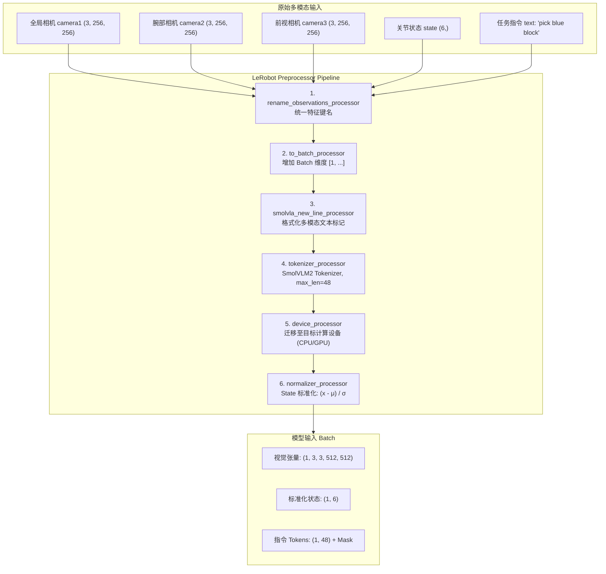
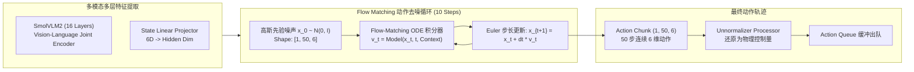
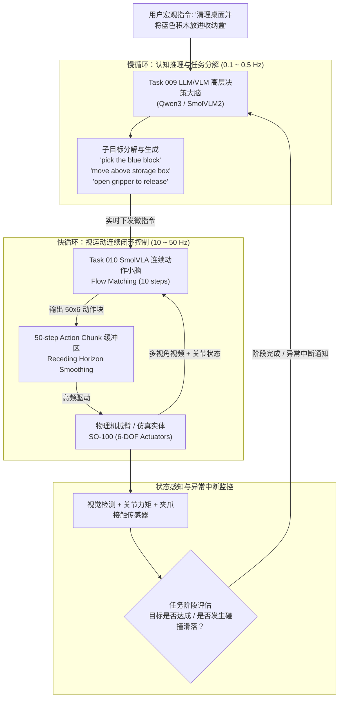

# VLA 输入输出全流程与分层架构分析报告

## 一、引言与体系定位

在机器人智能技术体系中，“大脑（Brain）”与“小脑（Cerebellum）”的分工是具身智能领域的核心命题。
- **Task 009** 代表了大脑层面的**高层离散动作语义推理（High-Level Action Semantics）**：接收静态符号化或离散视觉场景信息，输出 JSON 格式的高层动作意图（如 `pick`, `move_to`, `drop`）。
- **Task 010** 代表了小脑层面的**端到端连续动作轨迹控制（Low-Level Continuous Action Generation）**：接收高频多视角原始像素、本体关节感知与自然语言目标，输出多步长连续执行机构驱动量（Action Chunk）。

本报告深入解构 Hugging Face SmolVLA 的输入输出全生命周期，并全面对比两代架构的异同与工程协同方案。

---

## 二、SmolVLA 输入预处理全流程（Input Pipeline）

### 1. 视觉通道处理
- **多视角融合**：SmolVLA 支持多视角协同感知。在典型桌面机械臂场景中：
  - `camera1`：俯视全局工作台，捕捉宏观目标与障碍物空间分布；
  - `camera2`：机械臂末端手腕相机（Wrist Camera），消除视线盲区，提供毫米级精细抓取闭环对准视角；
  - `camera3`：侧前视相机，提供纵深与高度感知。
- **图像缩放与归一化**：输入图像保持 `[0.0, 1.0]` 的浮点 RGB 张量，并在模型内部利用双线性插值缩放至 `[512, 512]` 适配 SmolVLM2 视觉编码器，视觉特征采用 `IDENTITY` 保持原始分布。

### 2. 本体关节感知（State）
- **维度与物理意义**：6 维向量对应 SO-100 的 6 个驱动电机绝对位置（5 个关节旋转角度 + 1 个夹爪位移）。
- **统计标准化（MEAN_STD）**：由于不同关节的活动范围（弧度/角度）差异显著（如底座旋转可达 $180^\circ$，而手腕微调仅几十度），预处理器加载真实机器人训练数据集的经验均值 $\mu \in \mathbb{R}^6$ 与标准差 $\sigma \in \mathbb{R}^6$，进行严格的 Z-score 标准化：
  $$\hat{s}_i = \frac{s_i - \mu_i}{\sigma_i + \epsilon}$$
  这避免了某些大行程关节主导梯度，确保各个执行自由度处于平衡激活区间。

### 3. 语言指令编码（Language）
- 采用 `SmolVLM2-500M` 预训练分词器，最大序列截断/填充长度设定为 48。
- 文本指令通过 Cross-Attention 层与视觉特征在 VLM 骨干网络中深度交叉融合。

---

## 三、模型核心推演：流式匹配（Flow Matching Action Chunk）

### 1. 为什么是 Action Chunking？
传统机器人控制策略常采用单步反应式预测（Single-step Markovian Policy）：每个控制周期预测一个下一步动作。在存在高延迟（如 VLA 大模型）与累积误差时，单步预测极易导致机械臂颤抖（Jittering）与轨迹失稳。
**Action Chunking 机制**（一次性预测未来 $H=50$ 步动作）：
1. **时间一致性（Temporal Coherence）**：模型在全局时间轴上规划平滑、无突变的连续运动轨迹；
2. **容忍推理延迟**：一次计算提供未来 5.0 秒（10 Hz）或 1.0 秒（50 Hz）的控制指令，底层控制器可在执行当前 Chunk 期间并发运行下一个 Chunk 的推理。

### 2. Flow Matching 生成原理解析
不同于传统扩散模型（Diffusion Models）需要繁琐的多步前向加噪与复杂的噪声调度函数，**Flow Matching** 是一种更加高效直接的生成建模范式：
- 它直接在噪声分布 $p_0(x)$ 与真实动作分布 $p_1(x)$ 之间建立直线概率流（Straight-line Probability Paths）。
- 模型训练目标是直接预测速度场向量 $v_t(x_t, t) = x_1 - x_0$。
- 在推理阶段，仅需极少采样步数（实测仅需 10 步），即可高保真收敛生成完整的 50 步轨迹。

---

## 四、Task 009 与 Task 010 本质对比

| 比较维度 | Task 009（LLM/VLM 动作语义基线） | Task 010（SmolVLA 真实连续动作） |
| :--- | :--- | :--- |
| **模型角色** | 认知决策大脑（Cognitive Planner） | 运动控制小脑（Motor Controller） |
| **核心模型** | Qwen3-0.6B / SmolVLM2-2.2B | SmolVLA-450M (`lerobot/smolvla_base`) |
| **输入模态** | 结构化检测框 / 单张静态图像 / 自然语言 | 3 路多视角原始视频流 + 6 维关节感知 + 语言 |
| **输出形式** | 离散符号 JSON（`action: pick`, `target: box`） | 连续数值矩阵（`[50, 6]`，50 个步长的 6 维轨迹） |
| **动作空间** | 离散动词集合（10 种预定义动作语义） | $\mathbb{R}^{50 \times 6}$ 连续无限维位形空间 |
| **推理机制** | 自回归 Next-Token 预测 | 10 步 Flow Matching 向量场常微分方程数值求解 |
| **执行周期** | 慢频，秒级触发（0.1 Hz ~ 0.5 Hz） | 高频，毫秒级执行（10 Hz ~ 50 Hz） |
| **泛化层级** | 语义级泛化（理解常识、任务逻辑与因果） | 物理级泛化（空间轨迹避障、视觉伺服与接触顺应） |
| **物理接地性** | 无法直接驱动舵机与电机；无闭环关节反馈 | 直接输出电机目标角度或末端位姿增量 |

---

## 五、分层协同系统架构设计（Hierarchical Architecture）

为解决 LLM 高层缺乏微观物理控制能力、而低层 VLA 缺乏长程长任务逻辑推理能力的痛点，最佳工程实践是构建**分层分频异步协同架构**：

### 1. 慢循环（Slow Cognitive Loop）
- **职责**：全景感知、环境上下文建模、长任务状态机维护。
- **输入**：用户指令、全局场景图像、历史完成事件列表。
- **输出**：当前时间步的原子语言子目标（Sub-goal），例如 `"approach blue block from top"`。

### 2. 快循环（Fast Sensorimotor Loop）
- **职责**：高频视觉伺服控制（Visual Servoing）与连续动作执行。
- **输入**：来自慢循环的子目标文本、本地 3 路相机连续视频帧、实时 6 维关节编码。
- **输出**：50 步连续轨迹块，并通过实时动作队列平滑下发至底层电机驱动器。

### 3. 异步平滑衔接（Receding Horizon & Temporal Blending）
在快循环中，并非等待 50 步动作全部执行完毕才开始下一次推理。推荐采用 **滚动时域重规划（Receding Horizon Planning）**：
- 在第 0 步生成 50 步 Chunk 并开始执行；
- 当执行到第 15~20 步时，基于最新观测异步发起下一次 Chunk 推理；
- 当新 Chunk 到达时，通过加权指数平滑（Temporal Blending）与旧 Chunk 残余步骤混合，彻底消除轨迹衔接处的速度突变与顿挫。

### 4. 异常检测与双向反馈机制
- 若快循环监测到末端力矩异常（碰撞阻力突变）或目标积木意外脱落滑落，底层控制器立即将当前 Chunk 截断并紧急停机；
- 向上层慢循环抛出 `EXCEPTION: SLIP_DETECTED` 结构化事件；
- 慢循环重新观察现场视觉状态，触发动态补救决策。
